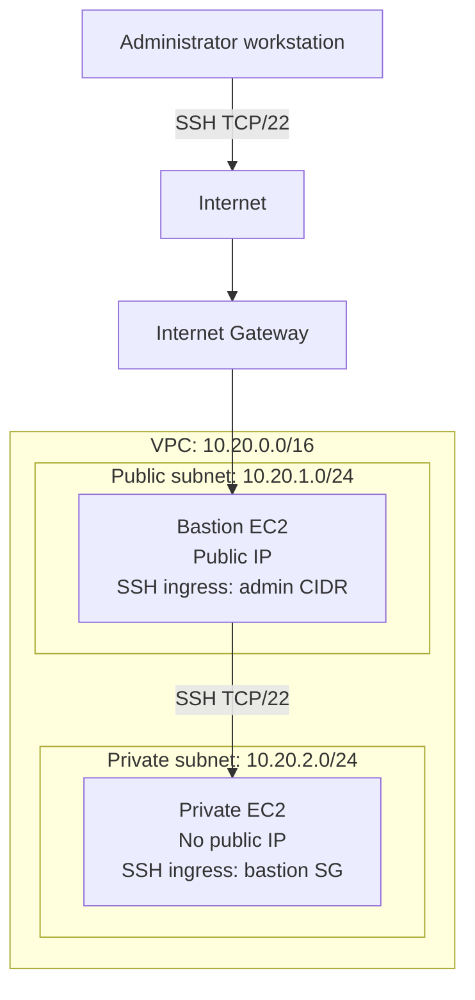

# Architecture Overview

## 1. Purpose

This document describes the network architecture for the AWS Bastion and Private EC2 Terraform project.

The project is a proof of concept (POC) designed to demonstrate network segmentation, controlled administrative access, and private-instance isolation. It also establishes a foundation for future improvements involving security, scalability, and operational practices.

## 2. Architecture Overview

The infrastructure is deployed in a dedicated VPC with separate public and private subnets.

The public subnet hosts the bastion EC2 instance, which provides the designated SSH entry point. The private subnet hosts an EC2 instance without a public IP address.

The public subnet has a default route to the Internet Gateway. The private subnet has no internet default route, and no NAT Gateway or VPC endpoints are currently configured.

## 3. Network Addressing

| Component | CIDR | Purpose |
|---|---|---|
| VPC | `10.20.0.0/16` | Dedicated project network |
| Public subnet | `10.20.1.0/24` | Bastion host |
| Private subnet | `10.20.2.0/24` | Private EC2 workload |

The VPC CIDR was selected to avoid overlapping with the identified existing VPCs and to provide room for future subnet allocations.

See [ADR-0001: VPC CIDR Allocation](adr/0001-network-cidr-allocation.md).

## 4. Architecture Diagram

The diagram illustrates the intended administrative path. It is a logical representation and does not depict every AWS routing or security-group evaluation detail.

## 5. Components

### VPC

The VPC provides the project's network boundary and address space. Its CIDR is `10.20.0.0/16`.

### Public subnet

The public subnet uses `10.20.1.0/24` and hosts the bastion EC2 instance.

Its route table includes a default route to the Internet Gateway. Internet reachability also depends on the instance's public addressing and applicable network security controls.

### Private subnet

The private subnet uses `10.20.2.0/24` and hosts the private EC2 instance.

The instance does not receive a public IP address. The private subnet has no configured internet default route, and the design does not currently include a NAT Gateway or VPC endpoints.

### Internet Gateway

The Internet Gateway provides the VPC's internet connectivity path for resources configured with suitable routing, addressing, and security controls. The public subnet's default route points to this gateway.

### Security groups

The security groups enforce the intended SSH access boundaries:

- Bastion ingress allows TCP port 22 from the configured administrator CIDR.
- Private-instance ingress allows TCP port 22 from the bastion security group.
- Bastion egress explicitly allows TCP port 22 to the private-instance security group.
- Neither security group has unrestricted egress configured.

Security groups are stateful, allowing response traffic for permitted connections.

### EC2 instances

Both instances use the configured Amazon Linux 2023 AMI lookup and are configured to require IMDSv2, use encrypted `gp3` root volumes, and enable EC2 API termination protection.

The bastion receives a public IP address. The private instance does not.

## 6. Traffic Flows

### Administrative SSH to the bastion

1. The administrator initiates an SSH connection to the bastion's public IP.
2. The public subnet's routing and Internet Gateway provide the internet connectivity path.
3. The bastion security group permits inbound SSH only from the configured administrator CIDR.
4. The administrator must also possess valid SSH credentials.

### SSH from the bastion to the private instance

1. The administrator establishes an SSH session to the bastion.
2. From the bastion, the administrator initiates SSH to the private instance's private IP.
3. The bastion security group's egress rule permits TCP port 22 to the private-instance security group.
4. The private-instance security group permits inbound TCP port 22 from the bastion security group.
5. The private subnet's local VPC routing supports communication between the two subnets.

This design avoids exposing the private instance directly to the internet.

### Outbound traffic from the private instance

The private instance has no internet default route and no explicitly configured security-group egress rules.

Consequently, general outbound internet access is not provided by the current design. Additional connectivity must be designed and reviewed if future workloads require it.

## 7. Current Limitations

- The architecture has not been deployed as part of this project workflow.
- SSH through the bastion is the designed administrative access method.
- AWS Systems Manager Session Manager is not configured.
- There is no NAT Gateway or VPC endpoint configuration.
- The design currently includes one public subnet and one private subnet; multi-AZ resilience has not been established.
- Monitoring, alerting, and operational recovery procedures require further development.

These limitations are intentional POC boundaries, not claims that the architecture is production-ready.

## 8. Related Documentation

- [Security Design](SECURITY.md)
- [ADR-0001: VPC CIDR Allocation](adr/0001-network-cidr-allocation.md)
- [ADR-0002: Bastion-Based SSH Access](adr/0002-bastion-ssh-access.md)
- [ADR-0003: Private Instance Isolation](adr/0003-private-instance-isolation.md)